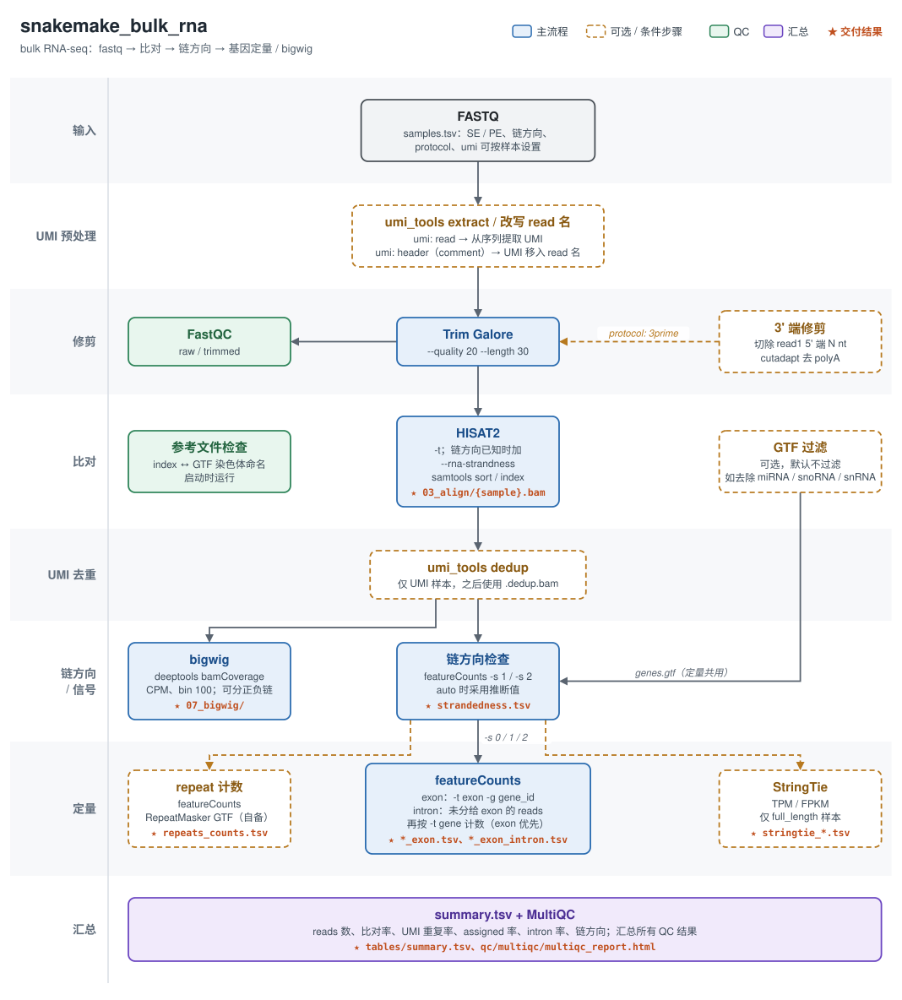

# snakemake_bulk_rna

[中文](README.md) | **English**

Local bulk RNA-seq pipeline (Snakemake ≥ 9.12):



<sub>Solid boxes are the main workflow, dashed boxes are optional or per-sample conditional steps, green boxes are QC, and ★ marks deliverables (paths relative to `results/`). The diagram labels are in Chinese. PNG version: `docs/images/bulk_rna_workflow.png`.</sub>

<details>
<summary>Text version</summary>

```
fastq ─► (UMI extract) ─► trim_galore ─► hisat2 ─► (UMI dedup) ─► strandedness check ─► featureCounts ─► counts / CPM (exon, exon+intron) / TPM / FPKM
                 └─ FastQC (raw / trimmed)                     ├─► StringTie (optional)
                                                               ├─► repeat counting (optional)
                                                               └─► bigwig
                                          Summary: summary.tsv + QC report + MultiQC
```

</details>

**SE/PE** (auto-detected), **strandedness** (can be inferred), **full-length / 3'-end** and **UMI** can all be set per sample.

---

## Quick start

```bash
P=/home/LAB/lab_ab_1/pipeline/snakemake_bulk_rna
cd /path/to/project

# 1. Create a project config template (generated when the -c file does not exist); edit genome, library type, etc.
bash $P/run.sh -c config.yaml

# 2. Scan the fastq directory, write <outdir>/samples.tsv and preview the jobs
bash $P/run.sh -c config.yaml -i /path/to/rawdata -o rnaseq_out -n

# 3. Check rnaseq_out/samples.tsv, then run in the background
nohup bash $P/run.sh -c config.yaml -o rnaseq_out -j 48 -y > run.log 2>&1 &
```

- No environment needs to be activated: `run.sh` calls snakemake from `~/.conda/envs/omics` (use `SMK_ENV=<env path>` for another environment).
- There is one copy of the pipeline code shared by all projects; **each project passes its own config with `-c` (required)**.
  The pipeline reads the default `config/config.yaml` first and then overrides it with the `-c` file (nested keys are merged level by level), so a project config only needs the parameters that differ from the defaults.
  The merged configuration actually used by each run is archived in `<outdir>/logs/run_<time>/config.yaml`.
  The default config is the base for every project, so normally leave it unchanged; editing it affects resumed runs of all projects.
- Results and logs are written to the `-o` directory, so several projects can run at the same time.
- After an interruption or error, **rerun the same command to resume**.

### run.sh options

| Option | Description |
|---|---|
| `-c FILE` | Project config (required). If the file does not exist, a template is generated from the defaults and the script exits |
| `-i DIR` | fastq directory (only used on the first run, when the outdir has no samples.tsv yet) |
| `-o DIR` | Output directory, default `./rnaseq_out` |
| `-s FILE` | Use an existing sample sheet |
| `-j INT` | Maximum number of CPU cores, default 32 |
| `-n` | Preview only (dry-run) |
| `-y` | Run without asking |
| `-- ...` | Everything after is passed to snakemake as is |

---

## Input: samples.tsv

Generated by `run.sh -i`, or written by hand (tab-separated):

```
sample   fq1                        fq2                        strandedness  protocol  umi
ctrl_1   /data/ctrl_1_R1.fq.gz      /data/ctrl_1_R2.fq.gz
ctrl_2   /data/ctrl_2.fastq.gz                                 reverse
q3_1     /data/q3_1.fastq.gz                                                 3prime    read
```

- An empty `fq2` means single-end. Recognised paired-end names: `_1/_2`, `_R1/_R2`, `_R1_001/_R2_001`.
  If the first read names of `X_1` and `X_2` differ (i.e. they are two single-end replicates), they are treated as two single-end samples.
- **Empty `strandedness` / `protocol` / `umi` cells use the defaults under `library:` in the config**; filled cells override them for that sample.
- Sample names may only contain letters, digits, `.`, `_` and `-`.

---

## Library settings

### 1. Strandedness `strandedness`

| Value | Meaning | Typical kits |
|---|---|---|
| `reverse` | read1 is antisense to the transcript (featureCounts `-s 2`) | dUTP methods such as Illumina TruSeq Stranded, NEBNext Ultra II Directional; QuantSeq REV |
| `forward` | read1 is sense to the transcript (`-s 1`) | Lexogen QuantSeq FWD |
| `unstranded` | no strand information (`-s 0`) | Smart-seq2, non-stranded TruSeq / NEBNext Ultra |
| `auto` | inferred after alignment (default) | when unsure |

Every sample gets a strandedness check (counting with both `-s 1` and `-s 2`):

- Results are written to `results/tables/strandedness.tsv`.
- `frac_forward ≥ 0.8` → forward, `≤ 0.2` → reverse, `0.4–0.6` → unstranded.
- If the given value disagrees with the inferred one, the `status` column shows **MISMATCH** and the pipeline still uses the given value.
- With `auto` the inferred value is used; if it cannot be determined the sample is treated as unstranded and `status` is `auto_undetermined`.

Strandedness affects hisat2 `--rna-strandness`, featureCounts `-s`, StringTie `--fr/--rf` and stranded bigwigs.

### 2. Full-length / 3'-end `protocol`

| Value | Trimming | Expression matrices |
|---|---|---|
| `full_length` | trim_galore | counts, CPM, **TPM, FPKM**, optional StringTie |
| `3prime` | trim_galore + clipping the 5' end of read1 (`trim.3prime.clip_r1`) + polyA removal with cutadapt | counts, CPM (length normalisation is meaningless for 3'-end data, so no TPM/FPKM) |

### 3. UMI `umi`

| Value | Handling |
|---|---|
| `none` | no deduplication (standard for RNA-seq) |
| `read` | UMI in the read sequence: `umi_tools extract` before alignment (using `umi.pattern`), `umi_tools dedup` after alignment |
| `header` | UMI already in the fastq header: `umi_tools dedup` after alignment. The UMI is the last `umi.separator`-separated field, located by `umi.header_field` (see below) |

| `umi.header_field` | UMI location | Example |
|---|---|---|
| `name` (default) | end of the read name, before the space | bcl-convert: `@A00:...:2000:ACGTACGT 1:N:0:ATCACG` |
| `comment` | end of the comment after the space. Aligners drop everything after the space, so read names are rewritten to `@SRR123.1_ACGCAGGCCC` before alignment | DNBSEQ data downloaded from SRA: `@SRR123.1 V300...:2:CTCTCTAC:ACGCAGGCCC/1` |

At start-up the pipeline checks the first 1000 reads of every `umi: header` sample and stops with an error if the extracted UMIs are not equal-length ACGTN strings, so a wrong UMI location cannot silently skip deduplication.

With UMIs, downstream quantification uses the deduplicated `results/03_align/{sample}.dedup.bam`.

### Example settings for common kits

Follow the kit manual; these are for reference only:

```yaml
# QuantSeq FWD (no UMI)
library: {strandedness: forward, protocol: 3prime, umi: none}
trim: {3prime: {clip_r1: 12, polyA: true}}

# QuantSeq FWD + UMI Second Strand Synthesis Module (6 nt UMI + 4 nt TATA spacer at the start of read1)
library: {strandedness: forward, protocol: 3prime, umi: read}
umi: {pattern: NNNNNN}
trim: {3prime: {clip_r1: 4, polyA: true}}

# TruSeq Stranded mRNA, UMI written into the read name by bcl-convert
library: {strandedness: reverse, protocol: full_length, umi: header}
umi: {header_field: name, separator: ":"}

# DNBSEQ data from SRA, UMI at the end of the header comment
library: {umi: header}
umi: {header_field: comment, separator: ":"}
```

---

## Key config.yaml settings

| Key | Description |
|---|---|
| `genome` | `mm10` / `GRCm39` / `GRCh38`, mapping to the hisat2 index and Ensembl GTF under `references` |
| `gtf_filter.exclude_biotypes` | Optional gene biotypes removed from the GTF before quantification. Default `[]` (no filtering); use `[miRNA, snoRNA, snRNA]` to match the old vM25 setup |
| `threads` | Threads per task type; the total is set by `run.sh -j` and Snakemake schedules jobs in parallel |
| `stringtie.enabled` | Also output StringTie TPM/FPKM |
| `repeats.enabled` / `repeats.gtf` | Repeat counting (bring your own RepeatMasker GTF; chromosome names must match the hisat2 index, which is `1, 2, …, MT` for mm10). If enabled with an empty or missing GTF, the pipeline stops at start-up |
| `bigwig.split_strand` | Also output sense / antisense bigwigs |
| `keep.trimmed_fastq` | Default false: trimmed fastq files are deleted once used |
| `envs` | conda environments of the tools (`in202506`; `omics` for deeptools and featureCounts). Python scripts (summary, matrix merging, etc.) run in the environment that runs snakemake, so they match the Snakemake version |

At start-up the pipeline checks that chromosome names in the hisat2 index and the GTF match; the result is written to `results/qc/reference_check.txt`.

---

## Output

```
project/
├── samples.tsv                       # sample sheet of this project
├── results/
│   ├── tables/                        # ★ deliverables
│   │   ├── counts_exon.tsv            # gene_id, gene_name, gene_biotype, length, counts per sample (exons only)
│   │   ├── cpm_exon.tsv
│   │   ├── counts_exon_intron.tsv     # exon + intron counts (for nuclear RNA); length is the gene-body length
│   │   ├── cpm_exon_intron.tsv
│   │   ├── tpm_exon.tsv / fpkm_exon.tsv   # full_length samples only, by exon length
│   │   ├── stringtie_tpm.tsv / stringtie_fpkm.tsv   # optional
│   │   ├── repeats_counts.tsv         # optional
│   │   └── strandedness.tsv           # strandedness inference
│   ├── 00_raw/                        # symlinks to the raw fastq files (renamed to {sample}_R1/R2)
│   ├── 02_trim/reports/               # trim_galore reports
│   ├── 03_align/                      # {sample}.bam (+ .dedup.bam)
│   ├── 04_count/                      # featureCounts output per sample, strand/
│   ├── 05_stringtie/  06_repeats/  07_bigwig/
│   └── qc/
│       ├── report.html                  # ★ QC report (single file): overview, workflow & parameters, QC summary; definitions and references in workflow/report/qc_metrics.yaml
│       ├── summary.tsv                  # reads, mapping rate, assigned rate, etc. per sample (plain numbers)
│       ├── multiqc/multiqc_report.html  # ★ all QC in one report
│       ├── fastqc_raw/  fastqc_trimmed/
│       ├── hisat2/{sample}.summary.txt  # alignment statistics
│       ├── umi/                         # umi_tools extract / dedup statistics (UMI samples only)
│       └── reference_check.txt          # chromosome naming check of index and GTF
└── logs/
    └── run_<time>/                    # one per snakemake run; a resumed run only contains the jobs it actually ran
        ├── <step>/<sample>.log        # look here first when something fails
        ├── benchmarks.tsv             # runtime and memory of all jobs in this run (one table)
        ├── snakemake.log              # full snakemake output
        ├── config.yaml, samples.tsv   # config and sample sheet used in this run
        ├── pipeline.txt               # pipeline path, commit and command
        └── software_versions.tsv      # versions and paths of all tools
```

**Nuclear RNA-seq**: alignment is unchanged and every sample gets two sets of counts; choose by data type:

- `counts_exon.tsv` / `cpm_exon.tsv`: featureCounts `-t exon -g gene_id`, for whole-cell RNA.
- `counts_exon_intron.tsv` / `cpm_exon_intron.tsv`: exon first, following zUMIs. Reads are first counted on exons; reads not assigned to an exon
  are then counted on the gene body (`-t gene`) and added to the exon counts, so each read is counted once. Nuclear RNA contains a lot of unspliced pre-mRNA, so use this set.
- Reads in regions where two genes overlap (nested or antisense genes) are ambiguous and not counted for either gene, the same rule as for exon counting.
- Intron counting depends on strandedness; for unstranded data more intronic reads are lost in overlapping genes.
- TPM / FPKM are computed from exons only.

**Columns of summary.tsv** (reads are counted as single reads, R1 + R2 for PE; each rate uses the reads entering that step as the denominator, in %, with the denominator written in the header, matching tool reports, MultiQC and published references; reference values are in `results/qc/report.html`):

| Column | Meaning |
|---|---|
| `raw_reads` | reads before trimming |
| `clean_reads` | reads entering hisat2 |
| `mapped_reads` | mapped reads (clean_reads × hisat2 overall alignment rate) |
| `umi_dedup_reads` | reads after UMI deduplication (UMI samples only), counted by read name so multi-mapped reads count once. The UMI-tools section of MultiQC counts alignment records and is higher; use this table |
| `clean_rate (% of raw)` | clean_reads / raw_reads |
| `mapping_rate (% of clean)` | mapped_reads / clean_reads, i.e. the hisat2 overall alignment rate |
| `umi_dedup_rate (% of mapped)` / `umi_duplicates_rate (% of mapped)` | deduplicated reads / mapped reads before dedup; the two add up to 100 (UMI samples only) |
| `assigned_rate (% of counted)` | reads assigned to genes by featureCounts / reads entering featureCounts (deduplicated for UMI samples, mapped otherwise; fragments × 2 for PE) |
| `intron_rate (% of counted)` | intronic reads / reads entering featureCounts (see "Nuclear RNA-seq" above). Usually low for whole-cell RNA and much higher for nuclear RNA |
| `strand_*` | strandedness: given, inferred, used, status |

---

## Common tasks

```bash
# Resume: rerun the same command
bash $P/run.sh -c config.yaml -o rnaseq_out -y

# Run up to one step (all samples)
bash $P/run.sh -c config.yaml -o rnaseq_out -y -- --until featurecounts

# Force a step (and everything downstream) to rerun, e.g. after changing featureCounts options
bash $P/run.sh -c config.yaml -o rnaseq_out -y -- --forcerun featurecounts

# Add samples: append rows to samples.tsv and run; finished samples are not rerun

# The previous run was killed and the directory is locked
bash $P/run.sh -c config.yaml -o rnaseq_out -y -- --unlock

# Show why each step would (re)run
bash $P/run.sh -c config.yaml -o rnaseq_out -n -- --summary
```

After changing config parameters or updating the pipeline code, Snakemake reruns the affected steps automatically.

---

## Main changes from the old version

- Runs locally instead of submitting PBS jobs: every rule declares its threads and Snakemake schedules them.
- Parameters are no longer passed with `--config reads=<JSON>`; an editable samples.tsv is used instead, and `.fq.gz` is supported.
- SE/PE rules are merged and file names no longer carry `_pe` / `_se`.
- Quantification counts by `gene_id` and matrices carry annotation columns such as `gene_name`. cufflinks is replaced by TPM/FPKM computed from featureCounts, with optional StringTie.
- Fixed problems:
  - the merged repeat result was actually gene counts;
  - summary could not read snakemake parameters;
  - wrong structure of the human/mm9 GTF config;
  - hard-coded thread numbers.
- New: strandedness inference, 3'-end and UMI support, a unified MultiQC report, a QC report, and a record of every run in `logs/run_<time>/`.
